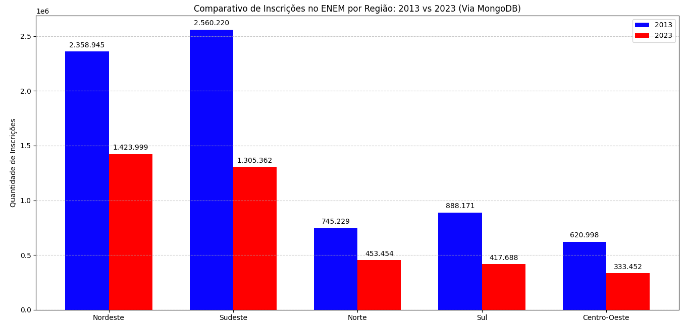
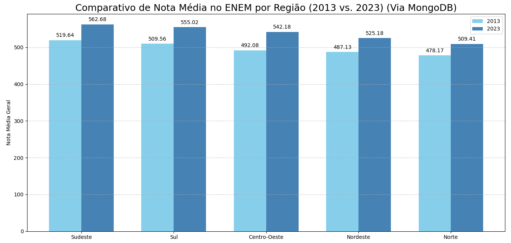
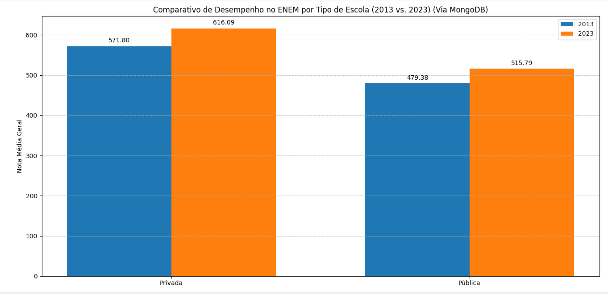
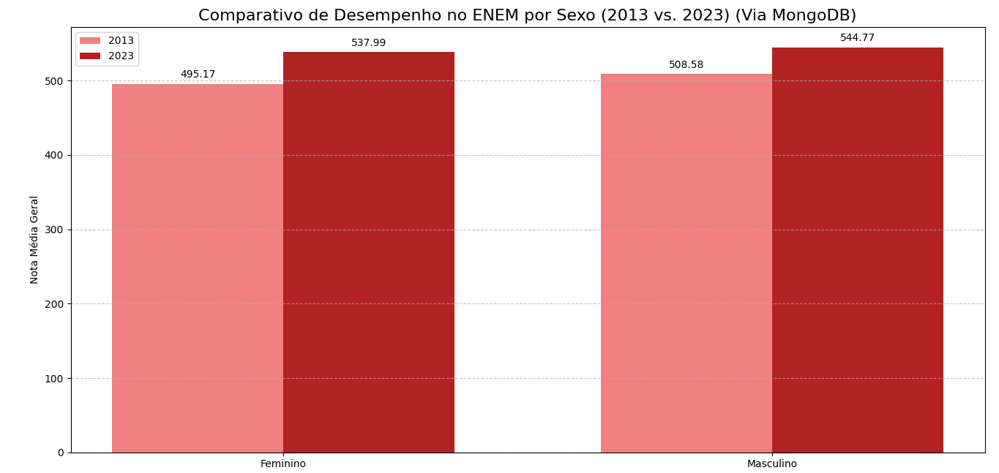

# Análise de Big Data: ENEM 2013 vs 2023

Comparação dos microdados do ENEM (INEP) entre 2013 e 2023, usando **MongoDB** para armazenar e consultar mais de 11 milhões de registros e **Python** (Pandas e Matplotlib) para tratar os dados e gerar os gráficos.

Projeto da disciplina de Big Data do curso de Ciência da Computação da Universidade Veiga de Almeida (2025).

## Problema e solução

Os arquivos CSV do ENEM são grandes demais para carregar inteiros na memória RAM. Para resolver isso:

- **Importação em lotes:** os CSV foram migrados para o MongoDB em blocos de 10.000 linhas (`0-importardados.py`).
- **Projections:** nas análises de nota, a consulta traz do banco apenas as colunas necessárias, em vez do documento inteiro.
- **Aggregation Framework:** as contagens (inscrições por estado e região, perfil de presença) são feitas dentro do próprio banco.
- **Pandas:** limpeza (`dropna`), criação da nota média e agrupamentos (`groupby` / `mean`) sobre o conjunto já reduzido.

> O MongoDB Atlas gratuito tem limite de 512 MB, que não comportava os dados. Por isso o banco foi executado localmente.

## Tecnologias

Python · MongoDB · PyMongo · Pandas · NumPy · Matplotlib

## Estrutura

| Script | O que faz |
|---|---|
| `0-importardados.py` | Importa os CSV para o MongoDB em lotes |
| `1-CompEst23-13.py` | Inscrições por estado |
| `2-CompReg23-13.py` | Inscrições por região |
| `3-CompEscolaPubPriv23-13.py` | Nota média: escola pública x privada |
| `4-PresD1D2-23.py` / `5-PresD1D2-13.py` | Perfil de presença nos dois dias de prova |
| `6-CompReg-Est23-13.py` | Nota média por região e por estado |
| `7-CompIngEsp23-13.py` | Nota média: inglês x espanhol |
| `8-CompSexo23-13.py` | Nota média por sexo |

## Como executar

1. Baixe os microdados do ENEM 2013 e 2023 no site do INEP: https://www.gov.br/inep/pt-br/acesso-a-informacao/dados-abertos/microdados/enem
2. Instale e inicie o MongoDB localmente (porta padrão `27017`).
3. Instale as dependências: `pip install pandas numpy matplotlib pymongo`
4. Em `scripts/0-importardados.py`, altere `PASTA_DADOS` para a pasta onde estão os CSV e execute o script. Ele cria o banco `enem_db` com as coleções `enem_2013` e `enem_2023`.
5. Execute os scripts de 1 a 8 para gerar os gráficos.

## Principais resultados

- As inscrições caíram de cerca de 7,2 milhões (2013) para 3,9 milhões (2023), mas **a nota média subiu em todas as regiões**.
- O **Nordeste** passou a ter mais inscritos que o Sudeste em 2023.
- A diferença de nota entre os sexos caiu de **13,41** pontos (2013) para **6,78** pontos (2023).
- Alunos de escolas privadas seguem com nota média maior que os de escolas públicas (616,09 x 515,79 em 2023).

### Gráficos

Os demais gráficos estão na pasta [`resultados`](resultados/).

## Autor

Igor Vieira Correa · [LinkedIn](https://www.linkedin.com/in/ivcorrea/)
